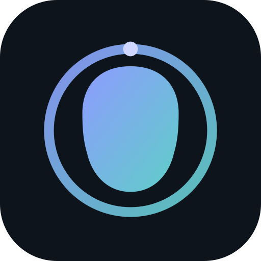

# checkup.report - your wellness picture, with just your phone

**checkup.report** brings vitals from your camera, a short voice check-in, movement, habits and mood into one timeline, each read against your own patterns. No wearable needed.

<a href="https://checkup.report/?utm_source=github&utm_medium=readme"><b>Start your free scan &rarr;</b></a> 
One free check-in every week.

## How a check-in works (as checkup.report describes it)
1. **Scan** - hold steady for a short camera reading; your raw video never leaves your device.
2. **Speak** - an optional 12-second voice check-in; the recording is deleted the moment it is measured.

## For developers
A Developer API: https://checkup.report/developers - API usage draws from the same weekly free allowance and credits as the app; there is no separate developer pricing.

## Please note
checkup.report is a wellness tool. It is not medical advice and does not diagnose or treat any condition.

## Sister products
Sister products: [ASI.EXPRESS](https://asi.express) · [8200.dev](https://8200.dev) · [DueVestor](https://duevestor.com) · [Foretell](https://foretell.technology) · [calculator.realestate](https://calculator.realestate)

Docs and images: [CC BY 4.0](LICENSE).